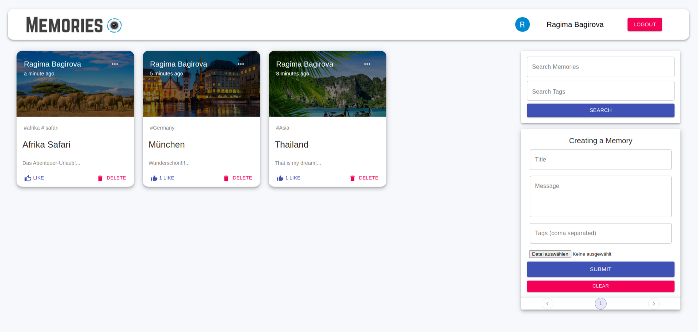

# Save Memories – Travel Social Platform

## About the Project

Save Memories is a social media application where users can share their travel experiences, upload photos, and interact with other travelers.

## Features

- User registration and authentication
- Create and share travel stories
- Upload travel photos
- Like and comment on posts
- User profiles
- Manage travel-related content

## Technologies

- React
- Redux
- JavaScript
- Node.js
- Express.js
- MongoDB
- Mongoose
- Material UI
- JWT Authentication

## Screenshots



## Getting Started

Clone the repository:

```bash
git clone https://github.com/Ragima2412/save-memories.git
```

Install dependencies in the client and server folders:

```bash
npm install
```

Start the backend and frontend in separate terminals using their respective start scripts.

## Project Purpose

This project demonstrates frontend and backend development, REST API integration, user authentication, database management, and state management with Redux.